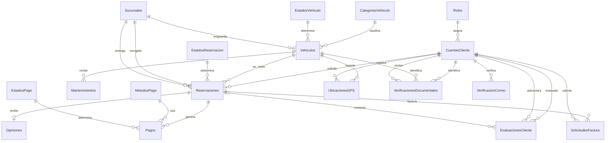

# Entrega de base de datos — Mexico Runs

## Revisión de normalización

- **Primera forma normal (1FN):** cada fila representa un registro y los campos guardan valores simples. Por ejemplo, una reservación referencia un solo cliente, un vehículo y sucursales; no guarda listas de vehículos dentro de una celda.
- **Segunda forma normal (2FN):** las tablas usan una clave primaria `id` de un solo campo. Los demás datos describen ese registro; no dependen de una parte de una clave compuesta.
- **Tercera forma normal (3FN):** los datos que se repiten se separan en catálogos y tablas relacionadas: roles, categorías, estados, métodos de pago y sucursales. Las tablas operativas guardan sus claves foráneas en lugar de repetir descripciones.
- **Opiniones:** ahora guarda la reservación, la calificación y el comentario. El cliente y el vehículo se obtienen de la reservación. La migración corrige esos datos en los registros anteriores antes de retirar las columnas repetidas.
- `Reservaciones.costo_total` conserva el precio acordado cuando se creó la renta; no se recalcula con la tarifa actual del vehículo, para preservar el historial.

## Entidades y relaciones principales



`PropuestasPropietario`, `BitacoraErrores` y `BitacoraAuditoria` no tienen relaciones obligatorias en el esquema actual. Las tablas de bitácora conservan eventos aunque cambien o se eliminen cuentas.

## Procedimientos almacenados CRUD

La migración `MejorasMexicoRuns.sql` instala `usp_CRUD_<Tabla>` para cada una de las **21 tablas de la aplicación**, además del procedimiento interno `usp_CRUD_Tabla`. Cada procedimiento acepta `CREATE`, `READ`, `UPDATE` o `DELETE`; `@datos` es un objeto JSON con los nombres reales de las columnas. Los campos de identidad se generan automáticamente y las claves foráneas siguen impidiendo borrar registros relacionados.

Ejemplos de lectura:

```sql
EXEC dbo.usp_CRUD_CategoriasVehiculo @accion = 'READ';
EXEC dbo.usp_CRUD_CategoriasVehiculo @accion = 'READ', @id = 1;
```

Ejemplo de alta (solo demostración; agrega un registro real):

```sql
EXEC dbo.usp_CRUD_CategoriasVehiculo
  @accion = 'CREATE',
  @datos = N'{"nombre":"Intermedio","descripcion":"Sedán mediano","tarifa_diaria":650}';
```

## Diagrama guardado en SQL Server Management Studio

El esquema ya tiene sus claves foráneas; SQL Server usa esas relaciones para dibujar las líneas. Para guardar el diagrama como objeto de la base de datos:

1. En SSMS, conecta a `(local)\SQLEXPRESS02` y expande **Bases de datos > MexicoRuns2**.
2. Expande **Diagramas de base de datos**. Si SSMS pregunta si instala los objetos de soporte, acepta.
3. Clic derecho en **Diagramas de base de datos > Nuevo diagrama de base de datos**.
4. Selecciona las 21 tablas de la aplicación, pulsa **Agregar** y luego **Cerrar**.
5. Acomoda las tablas por grupos: catálogos, cuentas, reservaciones y pagos, flota y operación. Confirma que aparecen las líneas de las claves foráneas.
6. Guarda con el nombre **Diagrama_ER_MexicoRuns**. Quedará guardado en `MexicoRuns2` y aparecerá en **Diagramas de base de datos**.

## Comprobación

Abre y ejecuta `database/verificar_entrega.sql` en SSMS con `MexicoRuns2` seleccionada. Muestra el conteo de tablas, relaciones, procedimientos CRUD, sedes y columnas de Opiniones. La validación CRUD realizada en la base local usó una transacción y revirtió el registro temporal.